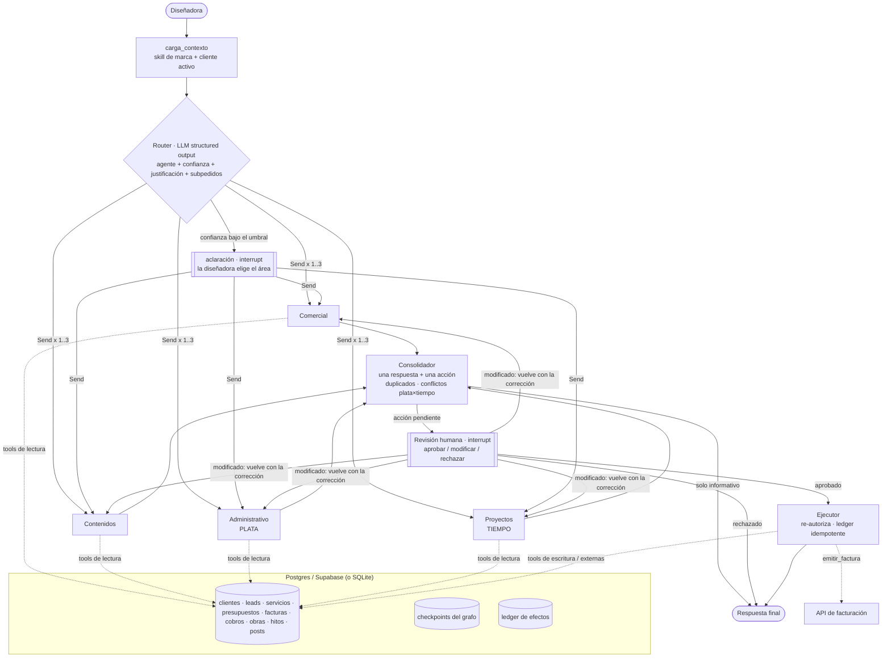

# Mora Estudio — Asistente multiagente para un estudio de interiorismo

Trabajo Final Integrador · Certificación Profesional en **AI Agent Developer** · ITBA Educación Ejecutiva · Cohorte 2026

## Integrantes
- Santiago Nieto

## Problema
Las diseñadoras de interiores que trabajan solas pierden buena parte de la semana en tareas administrativas y comerciales: responder y dar seguimiento a consultas de posibles clientes, armar presupuestos, facturar y perseguir cobros, sostener la presencia en redes y controlar plazos de obra. Son horas que se le restan al diseño, que es lo que realmente facturan. Estas tareas usan información dispersa (precios, obras, cobros, leads) y muchas terminan en una acción hacia afuera (un mensaje, una factura, un post) que no puede salir mal.

## Usuario / destinatario
Una diseñadora de interiores con un estudio en funcionamiento en Santa Fe (caso real). Usa el sistema como asistente: le pide cosas en lenguaje natural ("Facturale el saldo a Gómez", "¿Qué entregas tengo esta semana?") y aprueba, corrige o rechaza todo lo que el sistema quiera hacer hacia afuera.

## Descripción
Un **router** interpreta cada pedido y lo **delega** a uno o varios de cuatro agentes especializados:

| Agente | Responsabilidad |
|---|---|
| **Comercial** | Calificar consultas nuevas (A/B/C), responderlas y hacer seguimiento de leads |
| **Contenidos** | Calendario editorial y borradores de posts (copy, hashtags y brief visual en texto) |
| **Administrativo** | **Plata**: presupuestos, facturación y seguimiento de cobros |
| **Proyectos** | **Tiempo**: hitos, entregables, plazos, atrasos y visitas de obra |

Flujo principal: *pedido → router (decide a quién delegar y con qué confianza) → agente(s) usan sus tools → consolidador (una respuesta + una propuesta) → **revisión humana** (aprobar / modificar / rechazar) → ejecutor → respuesta final*.

- Si el pedido es solo informativo ("¿cuánto facturé en octubre?"), se responde sin pedir aprobación.
- Si el router no está seguro, **pregunta** en vez de adivinar.
- Si el pedido mezcla áreas ("facturale el saldo a Gómez y avisale que se atrasan los muebles"), delega en paralelo y **consolida** los resultados en una sola aprobación, avisando conflictos (por ejemplo, cobrar un saldo "contra entrega" de una obra que se atrasa).
- **Ninguna acción con efecto externo se ejecuta sin aprobación.**

## Arquitectura



| Componente | Implementación |
|---|---|
| **LLM** | Gemini (`google-genai`) detrás de la interfaz `LLMProvider`, con structured output validado por Pydantic y un reintento. Modo `local` determinístico sin API key (baseline y tests) y fallback automático si el LLM falla |
| **Orquestación** | LangGraph `StateGraph` (`src/mora/graph.py`): router, delegación con `Send`, fan-in, consolidador, `interrupt()` y ejecutor |
| **Agentes** | `src/mora/agents/`: cada uno con instrucciones de frontera + skill de marca + **sus** tools. En modo LLM, agent loop: el modelo propone un paso y el runtime valida, aplica la policy y ejecuta solo lecturas, con máximo 5 pasos |
| **Tools** | 24 tools en `src/mora/tools/` con schema Pydantic, tipo (lectura / interna / externa), nivel de autonomía (1–4), riesgo y precondiciones de negocio |
| **Skill** | `skills/identidad-marca/`: tono, reglas y firma (siempre cargada). `references/` a demanda: criterios de presupuesto → administrativo; pilares de contenido y estilo visual → contenidos |
| **Estado / memoria** | `EstadoEstudio` (mensajes, cliente activo, decisión del router, tareas, acción pendiente, decisión humana, trazas) persistido con checkpointer (`PostgresSaver` / `SqliteSaver`). Conversaciones de varios turnos que sobreviven reinicios |
| **HITL** | `interrupt()` en `revision` (aprobar / modificar / rechazar, con versión y hash de la propuesta) y en `aclaracion` |
| **Integraciones** | PostgreSQL/Supabase (datos del estudio + checkpoints), Gemini API y facturación electrónica detrás de `FacturacionProvider` (hoy `MockFacturacion`) |
| **Interfaz** | FastAPI + UI web con chat, bandeja de aprobación y trazas (`src/mora/api.py`, `static/index.html`). También CLI (`mora chat`) |

Más detalle: [`docs/arquitectura.md`](docs/arquitectura.md) · [`docs/agentes.md`](docs/agentes.md)

## Decisiones técnicas
- **Multiagente, no agente único.** Los cuatro roles tienen herramientas, permisos y riesgos distintos: emitir una factura (irreversible, riesgo alto) no es lo mismo que sugerir un post. La separación está en el código: cada agente ve y puede proponer **solo** sus tools, y el riesgo de cada acción lo define el registry, no el LLM. Un agente único vería las 24 tools en cada decisión.
- **Router + delegación + consolidación.** La mayoría de los pedidos son de una sola área: el router delega a un agente y el consolidador pasa la propuesta sin cambios. Cuando un pedido mezcla áreas, delega en paralelo y consolida. La frontera más delicada (**administrativo = plata, proyectos = tiempo**) está en los prompts, en las tools de cada agente y en el dataset de evaluación.
- **Preguntar en vez de adivinar.** Debajo de un umbral de confianza (0,6) el router pide aclaración. Un router que deriva mal con seguridad es peor que uno que pregunta.
- **Modelo: Gemini.** Es el proveedor usado en el curso; tiene structured output nativo con JSON Schema (justo lo que necesitan el router y el agent loop) y costo bajo por consulta (medido en las trazas). Queda detrás de una interfaz, así que se puede cambiar de proveedor sin tocar los agentes.
- **Sin RAG.** Se evaluó y se descartó: la identidad de marca es poca, estable y debe estar siempre presente (va como **skill**); los precios necesitan exactitud y no similitud semántica (van en una **tabla** consultada por una tool). Candidato futuro: presupuestos históricos con PGVector en el mismo Postgres.
- **Persistencia.** Un solo Postgres (Supabase) para los datos del estudio, los checkpoints y el ledger de efectos: todos los agentes comparten la misma base y nadie inventa por su lado. SQLite para desarrollo y tests, con el mismo esquema.
- **HITL.** Los agentes **no ejecutan nada**: proponen. Todo lo que escribe datos o sale del estudio pasa por revisión. Al ejecutar, el sistema **re-valida** la policy y las reglas de negocio (no facturar dos veces el mismo cobro, no facturar de más, no repetir un recordatorio antes de 7 días). Un ledger con clave `conversación:acción:operación` evita duplicar efectos si se reintenta.

| Tipo de acción | Ejemplos | Nivel | Tratamiento |
|---|---|---|---|
| Lectura | hitos, cobros, precios, calendario | 1 | directo; si no hay nada que ejecutar, termina |
| Interna | registrar lead, actualizar hito, registrar cobro | 2 | revisión (riesgo bajo) |
| Externa | mensaje, presupuesto, factura, post, invitación | 3 | **aprobación obligatoria** |
| No delegable | descuentos | 4 | bloqueada por la policy |

## Instalación
Requiere **Python 3.11 a 3.14** (probado con 3.13). Con 3.15 algunas dependencias todavía no tienen versión precompilada.

```bash
git clone https://github.com/nietosantiago/Agentes-MoraEstudio.git
```
```bash
cd Agentes-MoraEstudio
```

Linux / macOS:
```bash
python3 -m venv .venv && source .venv/bin/activate
```
Windows (PowerShell):
```bash
py -3.13 -m venv .venv; .venv\Scripts\Activate.ps1
```

```bash
pip install -e ".[dev]"
```

## Configuración
```bash
cp .env.example .env
```

| Variable | Default | Para qué |
|---|---|---|
| `MORA_LLM` | `local` | `local` = sin LLM (reglas, sin API key) · `gemini` = router y agentes con LLM |
| `GEMINI_API_KEY` | — | Requerida si `MORA_LLM=gemini` |
| `MORA_GEMINI_MODEL` | `gemini-2.5-flash` | Modelo |
| `MORA_PRECIO_INPUT_1M_USD` / `OUTPUT` | 0.30 / 2.50 | Para estimar el costo en las trazas |
| `MORA_UMBRAL_ROUTER` | `0.60` | Debajo de este valor, el router pide aclaración |
| `MORA_DATABASE_URL` | vacío | Vacío = SQLite local · `postgresql://...` = Postgres/Supabase |
| `MORA_HOY` | hoy | Fecha de referencia. Usar `2026-11-02` con los datos de ejemplo |

El repositorio no contiene credenciales; `.env` está en `.gitignore`.

## Ejecución
Linux / macOS:
```bash
MORA_HOY=2026-11-02 mora serve
```
Windows (PowerShell):
```bash
$env:MORA_HOY="2026-11-02"; mora serve
```
Abrir **http://localhost:8000**. Otras opciones:

```bash
mora chat --cliente CLI-02
```
```bash
docker compose up --build
```
```bash
mora reset-db
```

`mora chat` es la conversación por terminal. `docker compose` levanta la app y un Postgres (sin probar en este entorno). `mora reset-db` vuelve la base a los datos de ejemplo.

## Uso — recorrido principal reproducible
Con `MORA_HOY=2026-11-02` y la base recién reiniciada:

1. **Decisión agéntica + consolidación + HITL**: en la UI, *Nueva conversación* y escribir:
   > Facturale el saldo a Martín Gómez y avisale que se atrasan los muebles de cocina
   - El router detecta dos tareas y delega en paralelo a **Administrativo** y **Proyectos** (panel *Router*).
   - Administrativo usa `cobros_pendientes` y propone `emitir_factura` por $ 1.340.000. Proyectos usa `consultar_obra` y propone `actualizar_hito` (atrasado) + `enviar_mensaje` a Gómez.
   - El consolidador arma **una sola propuesta** de riesgo alto y avisa: *"se cobra a Gómez y se atrasa su obra; si el saldo es contra entrega, quizás convenga esperar"*.
   - Podés **Aprobar** (se emite la factura, se actualiza el hito y sale el mensaje), **Modificar** (editar el mensaje o escribir "la nueva fecha es el 27/11": los agentes vuelven a proponer la versión 2) o **Rechazar**.
2. **Informativo**: "¿Qué entregas tengo esta semana?" se responde sin pedir aprobación.
3. **Aclaración**: "Fijate lo de Gómez" hace que el router pregunte a qué área va.
4. **Reglas de negocio**: aprobar dos veces la factura del mismo saldo (desde dos conversaciones) bloquea la segunda.

Más pedidos de ejemplo: "Me escribió Carla Benítez por Instagram: "quiero renovar la cocina, tengo 3 millones", es de Santa Fe" · "Armame el calendario de posts de diciembre" · "Presupuesto para Sofía Acuña: 2 ambientes y 3 renders" · "Mandale un recordatorio de pago a Gómez".

## Evaluación
**Tests** (`pytest -q`): 51 tests que cubren:
- las tools principales y la policy (permisos por agente, niveles, precondiciones);
- el recorrido principal y cada arista del grafo: informativo, aprobación, rechazo, modificación con versión nueva y aprobación desactualizada, aclaración, consolidación multiagente y falla parcial;
- la idempotencia ante reintentos y la persistencia entre procesos;
- el agent loop con un LLM guionado, la API y un flujo completo contra **PostgreSQL real** (se activa con `MORA_TEST_DATABASE_URL`).

**Evaluación del router** (`mora eval-router`, dataset en `eval/dataset_router.jsonl`): 40 casos (36 de un área, 4 multi-intención), 18 marcados como limítrofes. Resultado del baseline por reglas ([reporte completo](eval/reports/router_reglas_2026-11-02.md)):

| Métrica | Resultado |
|---|---|
| Accuracy | 92,5% |
| Pidió aclaración | 7,5% |
| **Derivó mal con confianza** | **0%** |
| Accuracy en limítrofes | 86,7% |
| Confusiones administrativo ↔ proyectos | 0 |
| Multi-intención delegada al conjunto correcto | 4/4 |

**Trazabilidad**: cada nodo registra latencia, llamadas al LLM, tokens de entrada y salida, costo estimado, modelo, tools usadas y errores. Se ve por turno en la UI y queda en el estado de la conversación.

> ⚠️ Resultados preliminares: el dataset es una semilla escrita por el autor de las reglas, así que el número es optimista. Pendiente: dataset con consultas reales de la clienta y comparación reglas vs. Gemini (ver [`docs/evaluacion.md`](docs/evaluacion.md)).

## Limitaciones
- Los datos de `data/seed/` y los valores de la skill de marca son **de ejemplo**, a reemplazar por el material real de la clienta.
- La **facturación** usa un mock con la misma interfaz que una API real (comprobantes marcados `MOCK`, sin validez fiscal). Los envíos de mensajes, la publicación de posts y el calendario se registran en la base, no salen a WhatsApp, Instagram ni Google Calendar.
- El modo **local** decide con reglas; la decisión agéntica con LLM requiere `MORA_LLM=gemini`.
- **Fuera de alcance**: generación de imágenes (contenidos entrega un *brief* en texto), WhatsApp como canal, RAG, multiusuario y autenticación.
- `docker compose` está escrito pero no se pudo probar en el entorno de desarrollo.

## Estructura del repositorio
```
src/mora/
  graph.py            grafo LangGraph (router, delegación, consolidador, HITL, ejecutor)
  consolidacion.py    consolidación de resultados multiagente
  agents/             router + comercial, contenidos, administrativo, proyectos
  tools/              registry + policy + tools por agente
  integrations/       facturación (interfaz + mock)
  llm/  tracing.py    proveedor Gemini, trazas de tokens/costo/latencia
  api.py static/      FastAPI + UI
  schema.sql db.py    esquema SQLite/Postgres
skills/identidad-marca/   skill reutilizable
data/seed/                datos de ejemplo
eval/                     dataset + reportes de evaluación
tests/                    51 tests
docs/                     arquitectura, agentes, evaluación, plan, contexto del TFI
```
