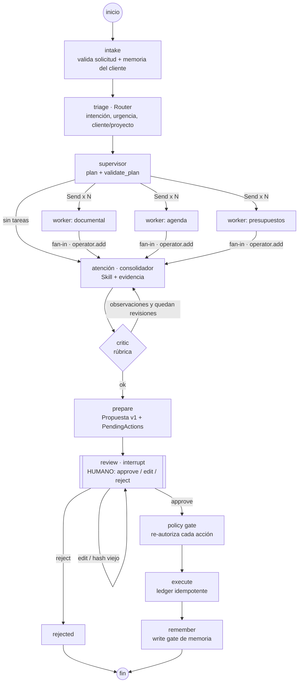

# Arquitectura y orquestación — Sistema de agentes de Mora Estudio

> Base conceptual: curso ITBA *AI Agent Developer* (Clases 1–13). Cada decisión cita la clase de la que sale.

## 1. Problema y alcance

Mora Estudio (arquitectura y diseño) recibe consultas por email, WhatsApp y web. Hoy el equipo las responde a mano y tiene que buscar en documentos, agenda y tarifario. El sistema:

| Proceso | Qué automatiza | Qué **no** automatiza |
|---|---|---|
| Atención / consultas | Clasificar, juntar evidencia y redactar el borrador | Enviar sin aprobación humana |
| Gestión de documentos | Encontrar fragmentos relevantes con su fuente (RAG) | Mostrar documentos de un cliente a otro |
| Agenda y vencimientos | Hitos próximos, horarios libres, proponer eventos | Crear eventos sin aprobación |
| Presupuestos / reportes | Calcular honorarios con el tarifario vigente | Comprometer descuentos (nivel 4) |

## 2. ¿Un agente o varios? (C12)

Arrancamos de la pregunta de C12: *¿qué separación reduce complejidad de verdad?* Hay cuatro motivos concretos:

1. **Permisos distintos**: presupuestos lee el tarifario, agenda lee el calendario y atención no lee fuentes por su cuenta. Separarlos aísla permisos (C9 Policy).
2. **Contextos distintos**: el informe de obra de un cliente no tiene que entrar al contexto de un presupuesto ni al de otro cliente.
3. **Paralelismo real**: documental y agenda (o presupuestos y documental) no dependen entre sí y corren en fan-out.
4. **Evaluación independiente**: el crítico verifica montos y políticas con una rúbrica propia.

Lo que **no** separamos: triage y supervisor son funciones determinísticas, con LLM opcional. No son "agentes" autónomos. Sin una razón clara, no sumamos agentes.

## 3. Patrones usados

| N.º (C12) | Patrón | Dónde |
|---|---|---|
| 01 | **Router** | `triage`: intención → plan |
| 04 + 03 | **Supervisor–Workers con Fan-out/Fan-in** | `plan` → `Send(worker)×N` → `consolidate` |
| 07 | **Generator–Critic** | `consolidate ⇄ critic` (máx. `max_revisiones`) |
| 06 | **Handoff a humano** | Reclamos: `escalar_a_humano=true` |
| C11 | **Prepare → Decide → Policy → Execute** | `prepare` → `review(interrupt)` → `policy` → `execute` |

## 4. Grafo de orquestación (LangGraph)

Código: `src/mora/graph.py`. Fachada: `src/mora/service.py` (`start`, `get`, `decide`).

### Estado compartido mínimo (C12)
`MoraState` guarda solo productos normalizados: `clasificacion`, `tasks`, `worker_outputs` (reducer `operator.add`), `respuesta`, `critica`, `propuesta`, `decision`, `resultados`, `trace` (reducer). Los workers reciben **solo** `task + solicitud + clasificacion` vía `Send`, nunca el historial completo.

### Durabilidad (C11)
- **Checkpointer**: `SqliteSaver` (`data/runtime/checkpoints.sqlite`), con `thread_id = run_id`. Un run sobrevive al reinicio del proceso: `mora run` y `mora decide` son procesos distintos.
- **Event log**: tabla `events` del ledger. Permite reconstruir quién decidió qué.
- **Ledger de efectos**: `idempotency_key = run_id:action_id`, con reserva `in_progress` antes del efecto. Si se re-ejecuta `execute` (recovery o time travel), la acción queda como `skipped_duplicate`. Hay un test para esto.
- **Outcome ambiguo**: si un efecto falla, queda `failed` en el ledger y **no** se reintenta solo.

### Semántica de reanudación
Cuando se reanuda, LangGraph vuelve a entrar al nodo que tiene `interrupt()`. Por eso `review` no tiene efectos y todo efecto vive en `execute`.

## 5. Contratos (C2, C9, C12) — `src/mora/contracts.py`

| Contrato | Entre | Campos clave |
|---|---|---|
| `SolicitudEntrante` | canal → sistema | contenido = **dato no confiable** |
| `Clasificacion` | triage → supervisor | intención, urgencia, `cliente_id`/`proyecto_id` (**siempre salen del repo, nunca del LLM**) |
| `WorkerTask` | supervisor → worker | `task_id`, rol permitido, objetivo, `success_criteria`, `depends_on`, `max_steps` |
| `WorkerOutput` | worker → consolidador | `status` success/partial/failed, `evidence[]` con fuente, `proposed_actions[]`, `open_questions` |
| `ConsolidatedAnswer` | atención → crítico/humano | `sources`, `contradictions`, `missing_information`, `skill`, `escalar_a_humano` |
| `Critique` | crítico → grafo | `passed`, `critical_issues`, `rubric_scores` |
| `Propuesta` | runtime → humano | versión, acciones, `proposal_hash` |
| `HumanDecision` | humano → runtime | approve/edit/reject, `proposal_hash`, `edited_answer`, `approved_action_ids` |
| `RunBudget` | runtime | `max_workers=3`, `max_parallel_workers=2`, `max_total_steps`, `max_revisiones` |

## 6. Tools, Policy y autonomía (C9 + C11) — `src/mora/tools/`

| Tool | Riesgo | Nivel | Puede leer | Puede proponer |
|---|---|---|---|---|
| `buscar_documentos` | read | 1 | documental, presupuestos | — |
| `consultar_proyecto` | read | 1 | documental, agenda, presupuestos | — |
| `listar_vencimientos` | read | 1 | agenda | — |
| `calcular_honorarios` | read | 1 | presupuestos | — |
| `registrar_presupuesto` | internal_write | 2 | — | presupuestos |
| `crear_evento_agenda` | side_effect | 3 | — | agenda |
| `enviar_respuesta` | side_effect | 3 | — | atención |
| `comprometer_descuento` | side_effect | **4 – no delegable** | — | nadie |

Hay tres preguntas separadas: **Registry** (¿qué existe?), **allowed_tools/can_propose** (¿qué puede este rol?) y **authorize_execution** (¿se ejecuta *esta* llamada?). La aprobación humana **no reemplaza** la policy: `policy` vuelve a validar el schema, el rol proponente, el nivel y el hash aprobado.

**Aislamiento entre clientes**: `buscar_documentos` descarta cualquier documento con `proyecto_id` distinto del proyecto de la consulta. Los eventos internos u otros clientes no se usan como evidencia de agenda.

## 7. Skills, contexto y memoria (C10)

- **Skills** (`skills/*/SKILL.md`): discovery solo por frontmatter (`name`, `description`, `mora-intents`). El body se carga cuando se selecciona la Skill y los `references/` bajo demanda. Las Skills **no** dan permisos.
  - `respuesta-cliente`, `presupuesto-honorarios` (+ política de descuentos), `gestion-reclamos`, `coordinar-reunion`.
- **Memoria** (`memory/store.py`): scope por `cliente_id` (o el contacto, si es un lead), con *provenance* (`run_id`), `confidence` y TTL.
  - *Write gate*: solo se escriben hechos de acciones **ejecutadas** después de la aprobación (por ejemplo, "Presupuesto PRES-… enviado", con TTL igual a la validez).
  - *Retrieve gate*: no vencidos, solo del mismo cliente, top-k.
  - La memoria **no es ground truth**: proyectos, agenda y tarifario se consultan siempre en su fuente.

## 8. Retrieval (C5–C8)

El contrato `Retriever.search(query, k, filters)` es independiente del backend. Hoy usa BM25 en memoria, con chunking por sección `##` y metadata del frontmatter (`proyecto_id`, `tipo`). La Fase 2 suma embeddings + Qdrant local y hybrid search con RRF detrás del mismo contrato, y se mide con Precision@k, Recall@k y MRR sobre un dataset de relevancia (C6).

## 9. Modos de ejecución

| Modo | `MORA_LLM` | Triage | Supervisor | Atención |
|---|---|---|---|---|
| Local determinístico | `local` | reglas | reglas | plantillas + Skill |
| Gemini | `gemini` | structured output → fallback a reglas | plan LLM → `validate_plan` → fallback | Skill como system prompt → fallback a plantilla |

En los dos modos, el runtime (no el LLM) define la identidad del cliente, las fuentes, los agentes participantes y el estado.

## 10. Fallas parciales (C12)

| Falla | Comportamiento |
|---|---|
| Worker lanza excepción o timeout | `WorkerOutput(status=failed)`. La respuesta sale `partial` y la falla figura en `missing_information` |
| Faltan datos (m², tipo) | `partial` con `open_questions`, que se le preguntan al cliente; no se estima |
| Plan inválido | `PlanError` → fallback determinístico, o run sin tareas con error visible |
| LLM caído o salida inválida | un retry de validación → fallback a reglas/plantillas |
| Aprobación con hash viejo | `decision_stale` → vuelve a `review`, sin efecto |
| Re-ejecución de `execute` | `skipped_duplicate` por ledger |

## 11. Métricas a instrumentar (C6, C12)

Routing accuracy (triage), task completion rate, evidence coverage, tasa de aprobación sin edición, ediciones por run, latencia p50 por nodo, tokens/costo por run (modo Gemini) y duplicados evitados por el ledger. La comparación tiene que ser **contra un baseline de agente único** (C9) sobre el mismo dataset de solicitudes.
