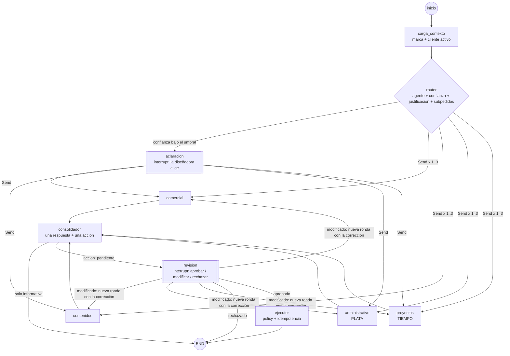

# Arquitectura y decisiones técnicas

> Fuente de verdad del alcance: [`contexto_tfi.md`](contexto_tfi.md). Este documento describe cómo está implementado y por qué.

## 1. Capas

```
┌──────────────────────────────────────────────────────────┐
│ Interfaz: FastAPI + UI mínima (src/mora/api.py, static/) │  + CLI (mora chat / eval-router)
├──────────────────────────────────────────────────────────┤
│ Grafo LangGraph: router + 4 agentes + HITL + ejecutor    │  src/mora/graph.py
├──────────────────────────────────────────────────────────┤
│ Tools por agente + Policy Gate + integraciones           │  src/mora/tools/, integrations/
│   facturación (interfaz; mock hasta elegir API)          │
├──────────────────────────────────────────────────────────┤
│ Postgres (Supabase) o SQLite: datos del estudio,         │  src/mora/schema.sql, db.py
│ checkpoints del grafo y ledger de efectos                │
└──────────────────────────────────────────────────────────┘
  Skill transversal: identidad de marca (skills/identidad-marca)
```

## 2. ¿Por qué multiagente? (requisito B)

Los cuatro roles tienen **herramientas distintas, permisos distintos y niveles de riesgo distintos** (ver la tabla de tools en [`agentes.md`](agentes.md)). Emitir una factura (riesgo alto, irreversible) no es lo mismo que sugerir un post (riesgo medio) o consultar hitos (lectura). Esa separación está en el código, no solo en los prompts:

- `ToolPolicy.lectura(agente)` / `propuesta(agente)`: cada agente ve y puede proponer **solo** sus tools.
- Un agente que intenta usar una tool ajena recibe `PolicyError` como observación (hay test).
- El riesgo y el "efecto externo" de una acción los calcula el **registry**, no el LLM.

Con un agente único con 24 tools, el modelo vería tools de facturación al redactar un post, y el riesgo de la acción dependería de su criterio.

## 3. El grafo



**Aristas condicionales** (las 3 del documento, más la delegación):
1. `salida_router`: si `confianza_router < MORA_UMBRAL_ROUTER` (0,6) → `aclaracion`; si no, **delegación**: un `Send` por subpedido (1 a 3 agentes, en paralelo), y cada agente recibe solo su subpedido más el pedido completo como contexto.
2. `salida_consolidador`: si hay `accion_pendiente` → `revision`; si la respuesta es solo informativa → END.
3. `salida_revision`: aprobado → `ejecutor`; modificado → **nueva ronda a los mismos agentes** con la corrección (único ciclo); rechazado → END; decisión con hash viejo → se vuelve a pedir y no se ejecuta.

### Delegación y consolidación (arquitectura B: "mecanismo de delegación + consolidación de resultados")
- **Delegación** (`agents/router.py`): el router parte el pedido en segmentos, rutea cada uno y agrupa los consecutivos del mismo agente. Un segmento sin señales ("y avisale") se pega al anterior. Solo es multi-intención si quedan ≥2 agentes distintos, todos con confianza ≥ umbral (máximo 3). En modo LLM, el structured output trae `subpedidos` y el runtime los valida.
- **Fan-in**: los resultados de los agentes se acumulan en `resultados_agentes` (reducer propio que se reinicia en cada ronda).
- **Consolidación** (`consolidacion.py`). Consolidar no es concatenar:
  - una respuesta con una sección por área y **una sola acción** (una sola aprobación);
  - se eliminan las operaciones duplicadas y se avisa si dos agentes le escriben a la misma persona;
  - **cruce plata × tiempo**: si en el mismo pedido se cobra o factura a un cliente cuya obra se atrasa, se avisa, porque el saldo suele ser "contra entrega";
  - **falla parcial**: si un agente falla, el resto sigue y la falla queda visible en "Para revisar".
- Cada operación conserva el agente que la propuso, y el ejecutor la autoriza **contra ese agente**: una acción consolidada no amplía permisos.
- En pedidos de una sola área, el consolidador pasa la propuesta sin cambios.

### Estado compartido (`EstadoEstudio`)
Respeta el del documento (`messages`, `cliente_activo`, `agente_destino`, `confianza_router`, `accion_pendiente`, `decision_humana`, `trazas`) y suma solo lo necesario para operar:

| Campo agregado | Para qué |
|---|---|
| `thread_id` | forma parte de la clave de idempotencia (ver §6: bug real encontrado) |
| `turno` | agrupar trazas por pedido dentro de una conversación |
| `justificacion_router`, `metodo_router` | evaluación del router y auditoría (reglas / llm / humano) |
| `correccion`, `cambios` | la modificación de la diseñadora que vuelve a los agentes (texto libre o edición de campos por índice) |
| `tareas`, `ronda`, `resultados_agentes` | delegación (subpedidos), número de ronda y fan-in de resultados |
| `resultado_ejecucion`, `estado` | qué se ejecutó, y el estado visible en la UI |

## 4. Decisiones técnicas

| Decisión | Implementación | Por qué |
|---|---|---|
| **Checkpointing obligatorio** | `PostgresSaver` si `MORA_DATABASE_URL` es Postgres; `SqliteSaver` en desarrollo. `thread_id = <cliente>-<uuid>` | `interrupt()` necesita congelar y retomar el grafo. Hay test de reanudación desde "otro proceso" con SQLite y con Postgres |
| **Router con structured output** | `DecisionRouter{agente, confianza, justificacion}`. Con Gemini usa `response_schema`; sin LLM, reglas ponderadas | La justificación alimenta la revisión manual de errores en el reporte de evaluación |
| **Umbral → aclaración** | `aclaracion` hace `interrupt()` con los 2 candidatos más probables | Derivar mal con seguridad es peor que preguntar. Métrica clave: *error con confianza* |
| **Identidad de marca = Skill** | `skills/identidad-marca/SKILL.md` en todas las llamadas; `references/` a demanda (criterios de presupuesto → administrativo, pilares → contenidos) | Poco contenido, estable, presente siempre: no va a un vector store |
| **Precios = tabla + tool** | tabla `servicios` + `calcular_presupuesto` determinística | Los precios necesitan exactitud, no similitud semántica |
| **RAG descartado** | no hay vector store en el TFI | Ver contexto §5. Si se retoma: presupuestos históricos con PGVector en el mismo Postgres |
| **Base compartida** | un solo esquema (`schema.sql`) para todos los agentes | Si cada agente tuviera su fuente, cada uno inventaría por su lado |
| **FastAPI, no WhatsApp** | `api.py` + `static/index.html` (bandeja de aprobación) | La aprobación de Meta puede tardar semanas y no suma nota. WhatsApp queda como extensión |
| **Facturación detrás de interfaz** | `FacturacionProvider` + `MockFacturacion` (comprobantes marcados `MOCK`) | Permite avanzar sin haber elegido la API (pendiente §9) |
| **Dos modos de agente** | `MORA_LLM=local` (reglas, sin API key) / `gemini` (agent loop) con fallback automático a local | Tests reproducibles, baseline para comparar y degradación controlada si el LLM falla |

## 5. Qué cuenta como "efecto externo" (resuelve el pendiente §9)

| Tipo | Ejemplos | Nivel | En el grafo |
|---|---|---|---|
| **lectura** | consultar hitos, cobros, precios, calendario de posts | 1 | el agente la usa directo; si no hay nada que ejecutar → END |
| **interna** | registrar lead, actualizar hito, registrar cobro | 2 | se propone y pasa por revisión (riesgo *bajo*, badge "interno") |
| **externa** | enviar mensaje a lead/cliente, enviar presupuesto, emitir factura, programar post, invitar a evento | 3 | se propone, **aprobación obligatoria**, riesgo medio/alto |
| **no delegable** | aplicar descuentos | 4 | la policy lo rechaza aunque el LLM lo proponga |

Regla: **los agentes no ejecutan nada**. Las internas también pasan por revisión en el TFI, porque así lo pide el documento y es lo más simple de defender. Si la clienta lo prefiere, el nivel 2 puede pasar a "automático + log" cambiando una línea en `ToolPolicy.autorizar`.

## 6. Ejecución segura

`ejecutor` (en `graph.py`), para cada operación de la acción aprobada:
1. **Ledger** (`efectos`): si la `idempotency_key = thread:accion:operación` ya existe, la operación queda `duplicada_omitida`.
2. **Re-autorización**: `ToolPolicy.autorizar` vuelve a validar agente, nivel, schema y **precondiciones de negocio** (por ejemplo: no facturar dos veces el mismo cobro, no facturar más que lo pendiente, no repetir un recordatorio de cobro antes de 7 días). La aprobación humana no reemplaza estas reglas.
3. **Reserva + efecto**: se inserta `en_curso`, se ejecuta y se marca `ejecutada` o `fallida`. Una falla (por ejemplo, la API de facturación caída) queda visible y **no se reintenta sola**.

> **Bug real encontrado en desarrollo**: la primera versión armaba la clave sin el `thread_id`, así que dos conversaciones con el mismo `accion_id` (`t1-proyectos`) se pisaban y la segunda acción quedaba omitida en silencio. Lo detectó la corrida end-to-end. Ahora tiene un test de regresión (`test_regresion_idempotencia_aislada_por_conversacion`).

## 7. Trazabilidad

Cada nodo está envuelto con `tracing.traced` y agrega a `trazas`: `turno, nodo, latencia_ms, llamadas_llm, tokens_in, tokens_out, costo_usd, modelo`, más datos propios del nodo (agente y confianza en el router, tools usadas, errores y modo en los agentes, resultados en el ejecutor). Los proveedores LLM reportan tokens a un `UsageMeter` por contexto. El costo se estima con precios configurables (`MORA_PRECIO_*`). La UI muestra la traza del turno y el acumulado de la conversación.
